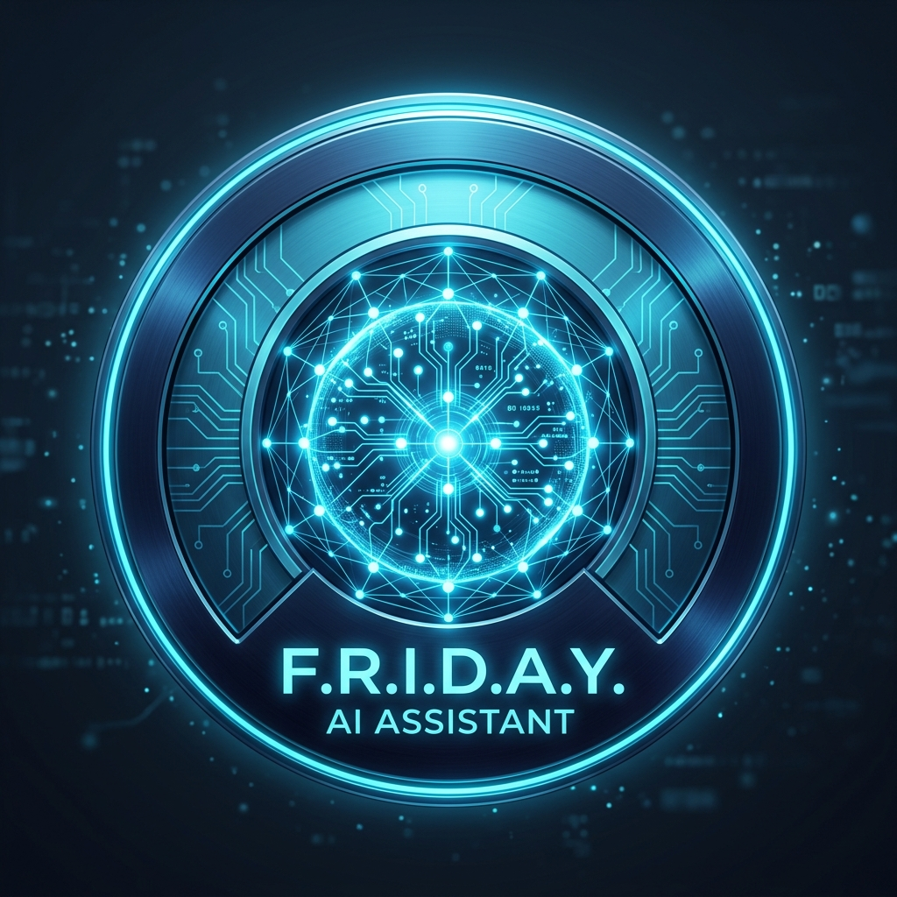

# F.R.I.D.A.Y. AI — Personal Desktop Assistant for Windows 11



**F.R.I.D.A.Y. (Female Replacement Intelligent Digital Assistant Youth)** is a fully functional, high-performance personal AI desktop assistant engineered for **Windows 11**.

Built with an offline-first architecture, local neural inference via **Ollama (Qwen3 4B)**, local speech synthesis and voice interaction, document extraction intelligence, Windows automation tools, and an enterprise-grade cloud database backed by **Supabase PostgreSQL** with strict **Row Level Security (RLS)**.

---

## ⚡ Architecture Overview

```
                      ┌────────────────────────────────────────┐
                      │    Windows 11 Desktop (Electron 34)    │
                      │    - Frameless Cyberpunk UI            │
                      │    - Restricted Preload Bridge         │
                      │    - Context Isolation & Sandbox       │
                      │    - System Tray & Native Controls     │
                      └──────────────────┬─────────────────────┘
                                         │ Localhost HTTP / IPC
                                         ▼
                      ┌────────────────────────────────────────┐
                      │      Python 3.11 Local FastAPI         │
                      │  - Background APScheduler              │
                      │  - Permissioned Windows Tool Registry  │
                      │  - Local SQLite DB (Offline Truth)     │
                      │  - File Intelligence (PDF, DOCX, TXT)  │
                      │  - pyttsx3 / SAPI Voice Synthesizer    │
                      └──────────────┬──────────────────┬──────┘
                                     │                  │
               Local AI Inference    │                  │  Cloud Backup & Sync
             (HTTP 127.0.0.1:11434)  │                  │  (PostgreSQL + RLS)
                                     ▼                  ▼
                          ┌──────────────────┐   ┌──────────────────┐
                          │      Ollama      │   │  Supabase Cloud  │
                          │   (qwen3:4b)     │   │  (FRIDAY-AI Org) │
                          └──────────────────┘   └──────────────────┘
```

---

## 🚀 Key Features

1. **Futuristic Desktop UI**:
   - Cyberpunk electric cyan, dark navy, and subtle neon purple aesthetic.
   - Central interactive **AI Orb** with dynamic visual pulses for standby, listening, thinking, and speaking states.
   - Glassmorphism design system built on **React, TypeScript, Vite, and Tailwind CSS**.
   - Custom frameless title bar with drag capability, real-time clock, status pills, and window controls.
   - System Tray integration: Run minimized, pause voice, or quit.

2. **Local AI Inference**:
   - Zero-cost local intelligence powered by **Ollama** and **Qwen3 4B Instruct**.
   - Model auto-discovery, live health checks, and runtime switching in Settings.
   - Streamed natural responses and structured tool-call execution.

3. **Voice Interaction & Daily Briefings**:
   - Push-to-talk microphone input with live speech recognition preview.
   - Offline text-to-speech engine configured with calm, intelligent cadence and instant interruption control.
   - Dynamic **Daily Briefings** reading aloud real-time date, pending tasks, upcoming reminders, and system status.

4. **Document & File Intelligence**:
   - Safe search across user-allowlisted directories (`Documents`, `Downloads`, `Desktop`, workspace).
   - Text and content extraction from **PDF**, **Word (.docx)**, **Markdown (.md)**, and **Plain Text (.txt)**.
   - Built-in AI document summarizer with read-only sandbox protection.

5. **Permissioned Windows Automation**:
   - Strict executable allowlist (`notepad`, `calculator`, `explorer`, `code`, `edge`, `chrome`).
   - Real-time hardware telemetry (CPU load, RAM consumption, storage availability, power/battery).
   - Native Windows 11 toast notifications via PowerShell.
   - Validated URL launcher.
   - **Global Emergency Automation Killswitch** (`AUTO ON` / `AUTO OFF`) accessible in the title bar, settings, and system tray.

6. **Offline-First Task & Reminder Engine**:
   - Local SQLite database (`backend/data/friday_local.db`) acts as local source of truth.
   - Automated background reminder scheduler checking alerts every 10 seconds.
   - Snooze controls (+15m) and automatic missed reminder recovery upon application reboot.

7. **Supabase Cloud Synchronization & Security**:
   - Version-controlled SQL migration applied directly to the `FRIDAY-AI` Supabase project (`ap-south-1`).
   - 8 fully protected tables with Row Level Security (RLS): `profiles`, `tasks`, `reminders`, `memories`, `notes`, `conversation_sessions`, `conversation_messages`, and `user_settings`.
   - Every operation strictly checked against authenticated `auth.uid() = user_id`.

---

## 🛠️ Getting Started

### 1. Environment Verification
Run the diagnostic script:
```powershell
python scripts/check_env.py
```

### 2. Development Mode
Start both the backend and frontend simultaneously:
```powershell
# Run backend
npm run backend:dev

# In a second terminal, launch Vite & Electron
npm run dev:electron
```

### 3. Automated Tests
Run the comprehensive backend test suite:
```powershell
npm run backend:test
```

### 4. Build Windows EXE Installer
Build the production NSIS setup installer:
```powershell
npm run dist
```
The installer will be generated in:
```
release/F.R.I.D.A.Y. AI Setup 1.0.0.exe
```

---

## 🔒 Security Architecture
- The language model is **never** granted arbitrary shell command execution.
- Paths outside of approved directories are strictly rejected.
- Electron context isolation and restricted preload bridge prevent remote code execution (RCE).
- No privileged database service keys are bundled or exposed.

---

## 📄 License
MIT License. Created for personal desktop productivity.
